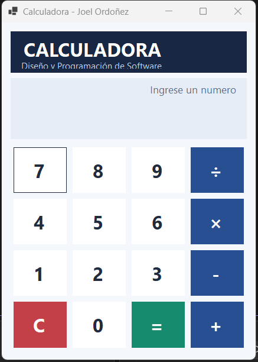
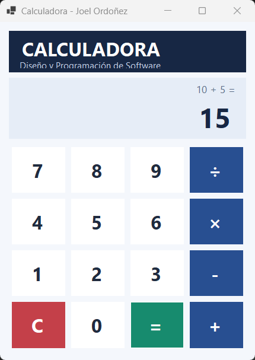
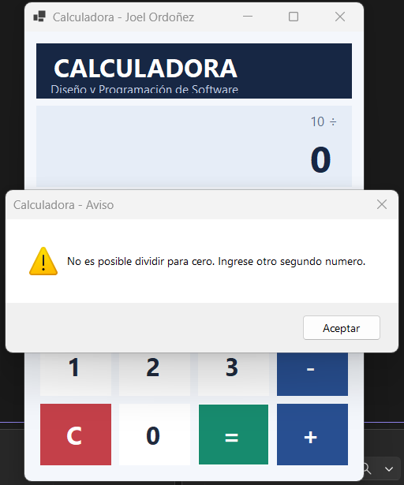

# Calculadora de escritorio — C# Windows Forms

**Actividad:** PPE09 — Diseño y Programación de Software  
**Autor:** Joel Ordoñez  
**Nombre del repositorio:** `PPE09_Ordonez_Joel_Calculadora`

## 1. Nombre del proyecto

**Calculadora**, aplicación de escritorio desarrollada en C# mediante Windows Forms.

## 2. Descripción general

Este proyecto consiste en el desarrollo de una calculadora de escritorio que permite realizar las cuatro operaciones aritméticas básicas: suma, resta, multiplicación y división.

Los números se ingresan mediante los botones de la interfaz gráfica y los resultados se visualizan en un control `TextBox` configurado como de solo lectura.

La aplicación utiliza programación orientada a eventos, métodos para organizar el código y validaciones para evitar errores durante su funcionamiento.

## 3. Objetivos

- Desarrollar una aplicación de escritorio utilizando C# y Windows Forms.
- Implementar controles gráficos y gestionar sus eventos `Click`.
- Realizar correctamente las cuatro operaciones aritméticas fundamentales.
- Validar entradas y mostrar mensajes comprensibles ante operaciones incorrectas.
- Diseñar una interfaz gráfica organizada, intuitiva y adaptable.
- Organizar y documentar el código fuente mediante un repositorio público de GitHub.

## 4. Características principales

- Diez botones numéricos del `0` al `9`.
- Cuatro operaciones aritméticas: suma (`+`), resta (`−`), multiplicación (`×`) y división (`÷`).
- Botón `=` para ejecutar las operaciones.
- Botón `C` para limpiar la pantalla y reiniciar los valores.
- Pantalla `TextBox` configurada con `ReadOnly = true`.
- Validación de entradas utilizando `double.TryParse()`.
- Control de división para cero mediante mensajes de error.
- Identificación de operaciones incompletas.
- Posibilidad de realizar operaciones consecutivas sin cerrar la aplicación.
- Reutilización del resultado anterior para realizar nuevos cálculos.
- Diseño adaptable al tamaño de la ventana mediante `TableLayoutPanel`.
- Interfaz gráfica con botones organizados y colores diferenciados.

La calculadora implementa los controles obligatorios establecidos en la guía. No dispone de un botón para ingresar el punto decimal, aunque puede mostrar resultados decimales obtenidos mediante las operaciones.

## 5. Tecnologías utilizadas

| Tecnología | Descripción |
|---|---|
| C# | Lenguaje utilizado para implementar la lógica de la calculadora. |
| Windows Forms | Tecnología utilizada para desarrollar la interfaz gráfica. |
| .NET 8.0 | Plataforma de ejecución del proyecto (`net8.0-windows`). |
| Visual Studio 2022 | Entorno de desarrollo utilizado para diseñar, programar y ejecutar la aplicación. |
| Git | Herramienta para el control de versiones. |
| GitHub | Plataforma para almacenar y publicar el código fuente. |

## 6. Requisitos de instalación

Para compilar y ejecutar el proyecto se requieren los siguientes componentes:

1. Sistema operativo Windows 10 u 11 compatible con .NET 8.
2. Microsoft Visual Studio 2022, versión 17.8 o posterior.
3. Carga de trabajo **Desarrollo de escritorio de .NET**.
4. SDK de .NET 8.
5. Git, en caso de utilizar el control de versiones o clonar el repositorio.

## 7. Instrucciones para ejecutar

### Opción A. Abrir el proyecto descargado

1. Descargar el proyecto desde GitHub.
2. Extraer los archivos en una carpeta del computador.
3. Abrir Microsoft Visual Studio 2022.
4. Seleccionar **Abrir un proyecto o una solución**.
5. Buscar y abrir el archivo `Calculadora.sln`.
6. Esperar a que Visual Studio cargue los componentes del proyecto.
7. Presionar `F5` para ejecutar la calculadora con depuración o `Ctrl + F5` para ejecutarla sin depuración.

### Opción B. Clonar el repositorio desde Visual Studio

1. Abrir el repositorio del proyecto en GitHub.
2. Seleccionar **Code** y copiar la dirección HTTPS del repositorio.
3. Abrir Visual Studio 2022.
4. Seleccionar **Clonar un repositorio**.
5. Pegar la dirección HTTPS y seleccionar la ubicación de destino.
6. Presionar **Clonar**.
7. Abrir `Calculadora.sln` y ejecutar el proyecto.

## 8. Estructura del proyecto

El repositorio se organiza de la siguiente manera:

- **PPE09_Ordonez_Joel_Calculadora/**
  - `Calculadora.sln` — Archivo de solución de Visual Studio.
  - **Calculadora/**
    - `Calculadora.csproj` — Configuración del proyecto y plataforma .NET.
    - `Form1.cs` — Código de eventos, operaciones y validaciones.
    - `Form1.Designer.cs` — Diseño y configuración de los controles gráficos.
    - `Program.cs` — Punto de entrada de la aplicación.
  - **capturas/**
    - `interfaz.png` — Interfaz principal de la calculadora.
    - `suma.png` — Ejemplo del resultado de una suma.
    - `division_cero.png` — Validación de división para cero.
  - `README.md` — Documentación técnica del proyecto.
  - `.gitignore` — Exclusión de archivos temporales y carpetas generadas automáticamente.

Las carpetas `bin` y `obj` no forman parte de los archivos publicados, debido a que contienen elementos generados durante la compilación.

## 9. Capturas de pantalla

### Interfaz principal

### Prueba de suma

### Validación de división para cero

## 10. Pruebas de funcionamiento

Se establecieron los siguientes escenarios para evaluar el funcionamiento de las operaciones aritméticas y las principales funcionalidades de la calculadora.

| N.º | Prueba | Resultado esperado |
|---|---|---|
| 1 | `10 + 5 =` | `15` |
| 2 | `20 - 8 =` | `12` |
| 3 | `7 × 6 =` | `42` |
| 4 | `100 ÷ 4 =` | `25` |
| 5 | `10 ÷ 0 =` | Mensaje de error sin cerrar la aplicación. |
| 6 | Presionar `C` después de una operación. | Pantalla vacía y reinicio de valores. |
| 7 | `15 + 25 =` | `40` |
| 8 | `3 × 3 =` y posteriormente `8 + 2 =` | `9` y después `10`. |

### Comprobaciones adicionales realizadas

**Validación de entradas y manejo de errores**

Se comprobó que la calculadora identifica operaciones incompletas y muestra mensajes comprensibles cuando se intenta realizar un cálculo sin ingresar los operandos necesarios. También se verificó el control de división para cero, evitando el cierre inesperado de la aplicación.

**Operaciones consecutivas**

Se verificó que la aplicación permite ejecutar diferentes operaciones sin necesidad de cerrarla. Además, se comprobó que el resultado de una operación puede utilizarse como primer operando de un nuevo cálculo.

**Diseño y adaptación de la interfaz**

Se realizaron pruebas de maximización y restauración de la ventana. Los botones mantuvieron su alineación y distribución, sin presentar superposiciones que dificultaran su utilización.

**Funcionamiento de los controles**

Se comprobó la interacción de los botones mediante eventos `Click`, así como la visualización de números y resultados en la pantalla de la calculadora.

## 11. Autor

**Joel Ordoñez**  
Asignatura: Diseño y Programación de Software  
Actividad: PPE09 — Desarrollo de una calculadora de escritorio con .NET Windows Forms.